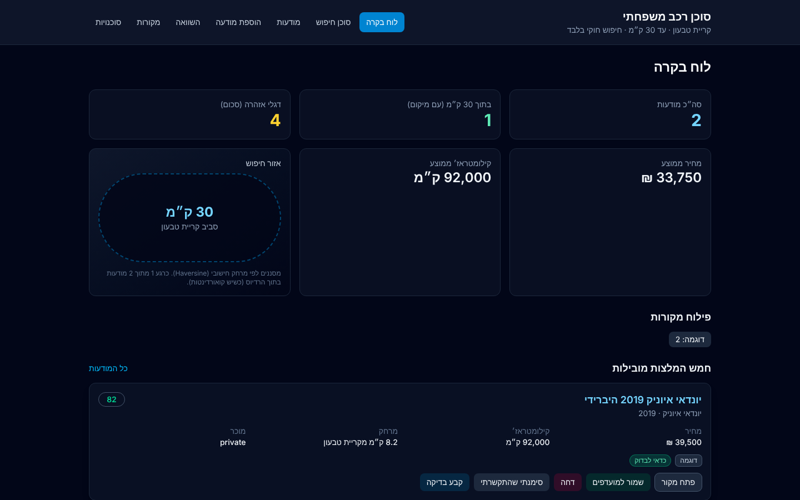

# Car Agent – Family Car Finder

A search agent for used family cars around Kiryat Tivon, Israel. It collects listings from several sources, filters them by distance, scores each listing and explains the score in Hebrew. The interface is in Hebrew (RTL).



## Features

- **Modular source adapters** – each data source is a separate class with a common interface: Google Custom Search API, saved search links (Yad2, Carwiz), manual URLs, dealership sites and CSV import
- **Processing pipeline** – normalize listings → filter by radius (Haversine distance) → score and explain → remove duplicates
- **Search profiles and run history** – save search preferences and review past runs
- **Listing details and compare pages** – compare cars side by side, with a purchase checklist, red flags and questions to ask the seller
- **CSV import** – supports English and Hebrew column names
- **Legal by design** – no CAPTCHA bypassing and no aggressive scraping; sources that cannot be queried automatically are saved as links for manual review

## Tech Stack

**Backend:** Python · FastAPI · SQLModel · SQLite · Pydantic Settings · httpx
**Frontend:** React · TypeScript · Vite · Tailwind CSS

## API (main endpoints)

| Area | Endpoints |
|------|-----------|
| Search | `GET/PUT /search/profile`, `POST /search/run`, `GET /search/runs`, `GET /search/runs/{id}` |
| Listings | CRUD on `/listings`, `POST /listings/import-csv`, `POST /listings/{id}/evaluate`, `POST /listings/deduplicate` |
| Sources | `GET/POST /sources`, `PUT /sources/{id}`, `POST /sources/{id}/test` |
| Dealerships | CRUD on `/dealerships` |
| Health | `GET /health` |

Interactive API docs: `http://127.0.0.1:8000/docs`

## Run Locally

**Requirements:** Python 3.11+, Node.js 20+

1. Backend (from the project root):
   ```bash
   pip install -r requirements.txt
   copy .env.example .env        # optional: Google API keys
   uvicorn backend.main:app --reload
   ```
2. Frontend:
   ```bash
   cd frontend
   npm install
   npm run dev
   ```
3. Open `http://localhost:5173`

Without Google API keys the app still works with the manual sources and CSV import. Set `VITE_USE_MOCK=true` in the frontend to run it with sample data only.

## What I Learned

- Designing a pluggable architecture (adapter pattern) so new data sources can be added without changing the core
- Building a data pipeline: normalization, geographic filtering, scoring and deduplication
- Building a full RTL interface in React and Tailwind

## Author

Yuval Dromi · [GitHub](https://github.com/yuvaldromi1)
